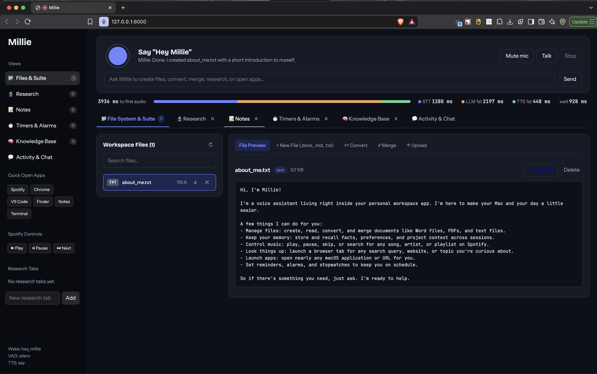
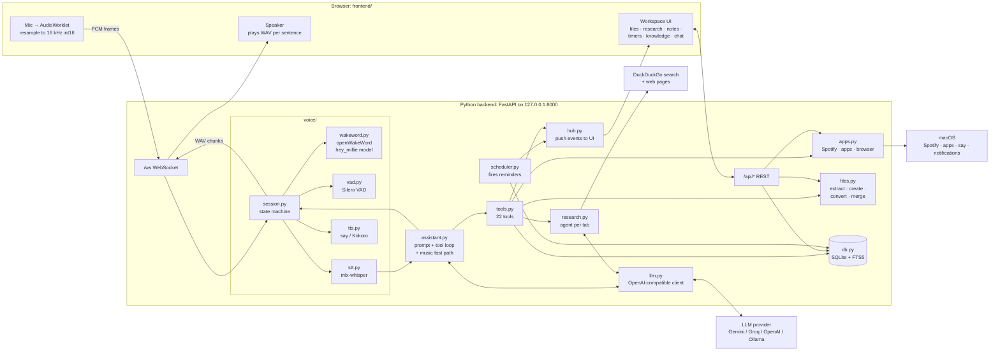
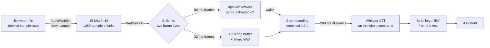
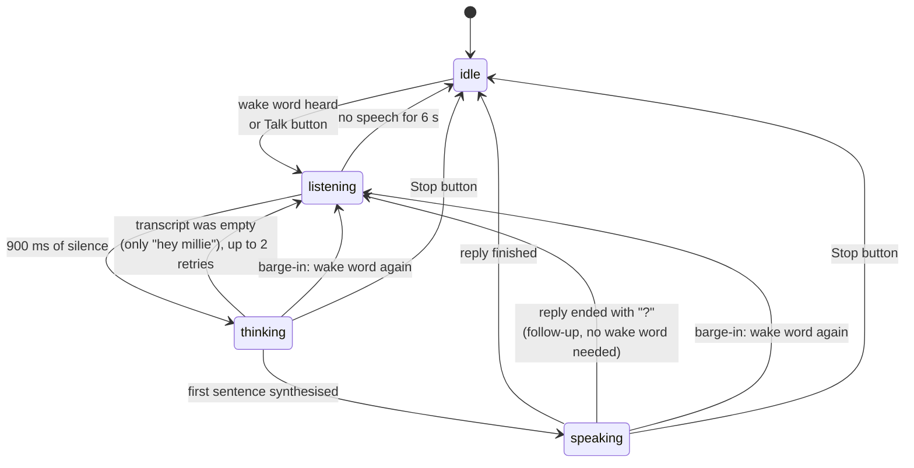
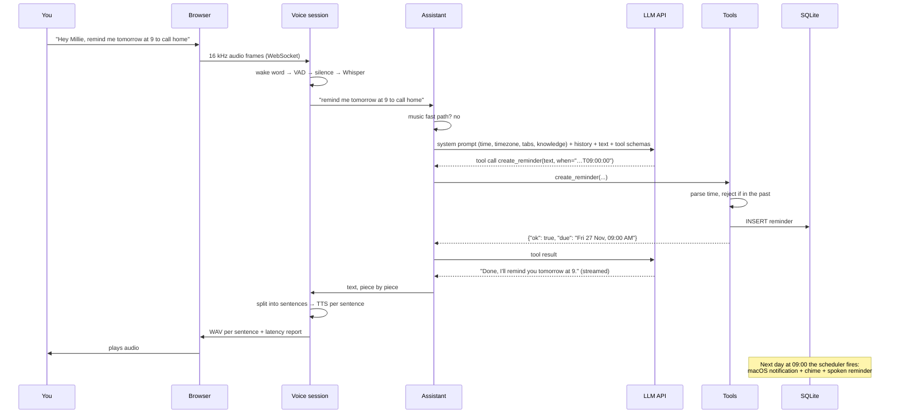
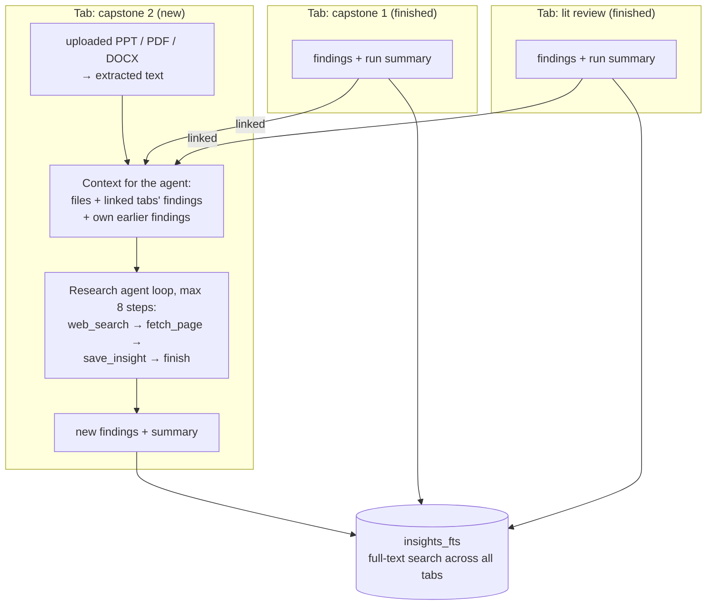
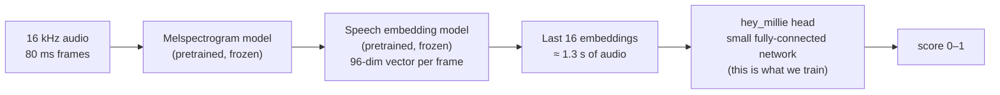

# Millie: Your personal assistant for everything

<p align="center">
  
</p>

A voice-first personal assistant that runs on your Mac. Say **"Hey Millie"**, then ask it to set a reminder, take a note, play a song, open an app, write a Word document, or research a topic in the background.

---

## 1. The problem it solves

Everyday computer tasks take a lot of small, separate steps. Setting a reminder means opening an app. Researching a topic means many browser tabs and copy-pasting notes. Starting music means finding the window, searching and clicking.

Cloud assistants (Siri, Alexa, Google Assistant) handle some of this, but they:
- send your audio to a server all the time,
- can't do research that builds on your earlier work,
- can't work with your own files, such as turning notes into a Word document or merging PDFs.

Millie puts all of this behind one voice command, on your own machine:

- **Hands-free.** It listens for its own custom wake word, "Hey Millie". The wake word, speech detection and speech-to-text all run on the device, so audio is not streamed anywhere.
- **One sentence, several actions.** For example: *"Set a reminder two days from now at 6:30 pm for my interview, and create a research tab called capstone 2 linked to capstone 1."* An LLM breaks the sentence into tool calls and plain Python code carries them out.
- **Research that builds on itself.** Each research tab runs its own background agent that searches the web and saves its findings. Tabs can be linked, so a new tab starts from what older tabs already found.
- **Your files, your data.** Notes, reminders, the knowledge base, research findings and workspace files are all stored locally (SQLite plus a `data/` folder). Only the LLM call and web search go out to the internet.

## 2. What device it runs on

| | |
|---|---|
| **Target device** | A Mac with Apple Silicon (M1–M4) running macOS |
| **Interface** | A local web page (Chrome or Safari) at `http://127.0.0.1:8000` |
| **Microphone / speaker** | The Mac's built-in mic and speakers, or any headset |
| **Server** | A Python process on the same Mac. It only accepts connections from that machine (127.0.0.1). |

Several parts use macOS-only tools:

| Feature | macOS tool it uses | On Linux / Windows |
|---|---|---|
| Speech-to-text | `mlx-whisper` (Apple GPU) | falls back to `faster-whisper` if installed |
| Spoken replies | `say` | use `TTS_BACKEND=kokoro` or `browser` |
| Spotify, app launching, opening the browser | `osascript`, `open -a` | not supported |
| Notifications | `osascript` | the in-page notice still works |
| OCR of images | `ocrmac` (Apple Vision) | `pytesseract` if installed |

Everything else (notes, reminders, research, files, knowledge base) works on any OS.

---

## 3. Architecture

### 3.1 The big picture



**In words:**
- The browser captures the mic and sends raw audio over a WebSocket.
- The backend runs the voice pipeline (wake word → VAD → speech-to-text) and passes the text to the assistant.
- The assistant asks the LLM which tools to call, then runs those tools in Python.
- The reply is spoken one sentence at a time and streamed back to the browser.
- The web UI also talks to the same backend over plain REST, for clicking instead of speaking.

### 3.2 Voice pipeline: what happens to your audio



Details that matter:
- **Wake word frames are 80 ms** (1,280 samples). That is the input size openWakeWord expects. After a trigger there is a 2-second cooldown so one "Hey Millie" can't fire twice.
- **VAD frames are 32 ms** (512 samples), the size Silero VAD expects. If Silero isn't installed, a simple loudness check is used instead.
- **The ring buffer keeps the last ~1.2 s of audio.** That's why *"Hey Millie, set a timer"* works in one breath: the words spoken right after the wake word are not lost.
- **End of command** is 900 ms of silence (`END_SILENCE_MS`). If you say nothing for 6 s after the wake word, Millie goes back to idle. Commands are capped at 30 s.
- **Whisper is not a streaming model**, so it runs once on the finished command. For short commands this is fast and accurate.

### 3.3 Conversation state machine (`voice/session.py`)



- **Barge-in:** saying the wake word while Millie is thinking or talking cancels the current reply and starts listening again.
- **Follow-ups:** if Millie's reply ends with a question mark, the mic reopens once the audio has finished playing. You can answer without saying "Hey Millie" again.
- **Typed input** goes through the same assistant and gets the same spoken reply.

### 3.4 One request from start to finish



**How the LLM and the code split the work:**
- **The LLM decides:** which tools to call and with what arguments. For example, it turns "tomorrow at 9" into an exact timestamp, using the current time and timezone given in the system prompt.
- **The code does the work and checks it:** a time in the past is rejected and sent back as an error. A tab name that matches several tabs comes back as a list. The LLM then turns these errors into a spoken follow-up question.
- **Limits:** up to 5 rounds of tool calls per request, and the last 6 messages are kept as conversation memory.

**Music fast path:** short music commands skip the LLM entirely and get the reply "Done.". Examples: "pause", "next", "play Bohemian Rhapsody", or a song title you've played before. This makes them fast and avoids spending LLM quota on them.

### 3.5 Research tabs



- **Each tab runs as its own background task,** so several tabs can research at the same time.
- **Linked tabs pass on their saved findings, not their whole chat history.** This keeps the context small.
- **Findings from every tab are searchable** with SQLite FTS5. That's how "What did my capstone tabs find about noise robustness?" works.

### 3.6 Data storage (`data/millie.db`)

| Table | Holds |
|---|---|
| `tabs`, `tab_links` | Research tabs and which tabs feed which |
| `messages` | Each tab's activity log |
| `files` | Files uploaded to a tab, with their extracted text |
| `insights` + `insights_fts` | Research findings and summaries, full-text indexed |
| `notes` | Quick notes |
| `reminders` | Reminders and alarms (`kind` column) |
| `stopwatches` | Stopwatches |
| `knowledge_base` + `knowledge_fts` | Long-term facts and preferences ("remember that…") |
| `music_catalog` | Songs resolved before, so they play instantly next time |

Workspace files (documents you create, convert or merge) are stored in `data/workspace/`.

---

## 4. The "Hey Millie" wake word model

The wake word detector is a small custom model trained with [openWakeWord](https://github.com/dscripka/openWakeWord). This section describes the training run that produced the current `hey_millie.onnx` / `hey_millie.tflite`.

### 4.1 How openWakeWord works



Only the last block is trained. The first two models are shared openWakeWord models that already turn audio into useful speech features. Because of that, a good detector can be trained mostly from synthetic speech, and the trained model is only a few hundred KB.

### 4.2 What it was trained on

**Positive examples** (people saying the wake phrase): 1,000 clips

| Source | Clips | How it was made |
|---|---|---|
| **My own voice** | 255 | 6 recordings, `hey_millie_01.wav` – `hey_millie_06.wav`. `01`–`05` were used for training: each original, plus 50 altered copies of each one. |
| **Synthetic voices** | 745 | Piper TTS, `en_US-libritts_r-medium` (a multi-speaker model trained on LibriTTS-R audiobook readers). Phrases: "hey millie", "hey milly", "hay millie" (plus "hey mili" in the first generation pass). |

How the 50 altered copies of each own-voice recording were made (`prep_my_voice.py` in the training notebook):
- speed changed ±15%
- pitch shifted up to ±3 semitones
- volume changed −8 to +6 dB
- light hiss added (15–40 dB signal-to-noise)
- room echo from real recorded rooms (30% of copies)
- background music or noise (50% of copies)

Before any of this, each recording was converted to 16 kHz mono and trimmed, with 0.25 s of silence added on each side.

**`hey_millie_06.wav` was held out.** It was never used for training or for choosing the best checkpoint, so testing on it is honest. With only one held-out clip, though, that test is a sanity check, not an accuracy figure.

**Negative examples** (things that must not trigger it):

| Source | Size | Purpose |
|---|---|---|
| Adversarial phrases (Piper TTS) | 1,000 train + 300 validation clips | Words that sound similar to "hey millie", generated automatically from the CMU pronunciation dictionary |
| ACAV100M precomputed features | ~2,000 hours | General speech, music and noise from the web |
| False-positive validation set | ~11 hours | Used to estimate false activations per hour |

**Augmentation applied to every clip** during training (on top of the copies above):

| Data | Size |
|---|---|
| MIT room impulse responses | 270 real rooms |
| AudioSet (balanced train, shard 09) | 500 clips |
| Free Music Archive | 120 × 30 s clips (1 hour) |

**Training settings:**

| Setting | Value |
|---|---|
| Model | openWakeWord DNN head, layer size 32 |
| Steps | 10,000 |
| Validation clips | 300 positive + 300 adversarial |
| Target false positives | 0.2 per hour |
| Max negative weight | 1500 |
| Hardware | Google Colab, NVIDIA T4 |
| Environment | Python 3.10, torch 2.1.2. Colab's default Python 3.13 / torch 2.14 break the openWakeWord training tools. |
| Output | `hey_millie.onnx` and `hey_millie.tflite` |


### 4.3 Using a trained model

Put the file in `data/` as `hey_millie.tflite` or `hey_millie.onnx`. If both exist, `.tflite` is loaded first. To use a different file, set `WAKEWORD_MODEL=path/to/model` in `.env`.

Tune `WAKEWORD_THRESHOLD` (default 0.5):
- **Raise it** if it triggers by itself.
- **Lower it** if it misses you.

The server log prints every score above 0.15, which makes tuning easier. If no custom model is found, Millie uses openWakeWord's built-in **"hey jarvis"** model.

---

## 5. Tech stack

| Layer | Technology |
|---|---|
| Backend | Python 3.11+, FastAPI, Uvicorn, WebSockets |
| Frontend | Plain HTML, CSS and JavaScript (no framework, no build step); Web Audio AudioWorklet for mic capture |
| Wake word | openWakeWord, custom `hey_millie` model; ONNX Runtime or LiteRT (TFLite) |
| Voice activity detection | Silero VAD (PyTorch); falls back to a loudness check |
| Speech-to-text | `mlx-whisper` (`whisper-small`) on Apple Silicon; `faster-whisper` elsewhere |
| Text-to-speech | macOS `say` (default), Kokoro-ONNX (optional, more natural), or the browser's built-in voice |
| LLM | Any OpenAI-compatible API through the `openai` Python client: Gemini (default), Groq, OpenAI, local Ollama |
| Storage | SQLite with FTS5 full-text search |
| Web research | `ddgs` (DuckDuckGo search), `httpx` for fetching pages |
| Documents | `pypdf`, `python-docx`, `python-pptx`, `reportlab` (PDF output), `markdown`, Pillow |
| OCR | `ocrmac` (Apple Vision); `pytesseract` as an alternative |
| macOS integration | `osascript` (Spotify, notifications), `open -a` (apps, browser) |
| Wake word training | openWakeWord training pipeline, Piper TTS, Google Colab T4 |

---

## 6. How to run it

### 6.1 Requirements
- Mac with Apple Silicon, macOS, Python 3.11 or newer
- An LLM API key (a free Gemini key from Google AI Studio works, as does Groq or any OpenAI-compatible endpoint)
- Chrome or Safari

### 6.2 Setup

```bash
cd millie
python3 -m venv .venv && source .venv/bin/activate
pip install -r requirements.txt
cp .env.example .env          # then put your key in LLM_API_KEY
mkdir -p data && cp /path/to/hey_millie.tflite data/   # your trained wake word model
./run.sh                      # opens on http://127.0.0.1:8000
```

The first start downloads the Whisper and Silero models, a few hundred MB.

### 6.3 Use it
1. Open `http://127.0.0.1:8000`, click **Start listening**, and allow the microphone.
2. Say **"Hey Millie"**, then your request. You can also press **Talk** or type into the box.
3. The bar under the mic shows how long the last request took at each stage: waiting for silence, speech-to-text, first LLM token, first TTS audio, and total time to first audio.

| Say | What happens |
|---|---|
| "Quick note: buy milk" | Saved under Notes |
| "Remind me tomorrow at 9 to call home" | Reminder. Fires as a macOS notification + chime + spoken |
| "Set a 10 minute timer" / "Set an alarm for 6:30 am" | Timer or alarm: chime plus a notice that stays until you dismiss it |
| "Start a stopwatch called study" / "Stop it" | Live stopwatch |
| "Create a research tab called capstone 2, link it to capstone 1, and research X" | New tab opens and its agent starts |
| "What did my capstone tabs find about noise robustness?" | Searches saved findings across tabs |
| "Remember that I prefer Python 3.11" | Saved to the knowledge base, included in future prompts |
| "Write a summary of my notes to summary.docx" | Creates a formatted Word document in the workspace |
| "Convert report.md to PDF" / "Merge a.pdf and b.pdf into all.pdf" | File conversion and merging |
| "Play Bohemian Rhapsody" / "Pause" / "Next" | Spotify control |
| "Open VS Code" / "Look up quantum computing on YouTube" | Launches the app / opens a browser tab |

### 6.4 Configuration (`.env`)

See `.env.example`. The main keys:

| Key | Default | Meaning |
|---|---|---|
| `LLM_API_KEY` | (none) | Required |
| `LLM_BASE_URL`, `LLM_MODEL` | Gemini | Any OpenAI-compatible endpoint and model |
| `LLM_STREAM` | `1` | Set to `0` if your provider's streamed tool calls misbehave |
| `WAKEWORD_MODEL`, `WAKEWORD_THRESHOLD` | auto, `0.5` | Wake word model path and sensitivity |
| `STT_MODEL`, `STT_LANGUAGE` | `whisper-small-mlx`, `en` | Speech-to-text |
| `TTS_BACKEND`, `TTS_VOICE` | `say`, `Samantha` | Spoken replies |
| `END_SILENCE_MS` | `900` | Silence that ends a command |
| `TIMEZONE` | `Asia/Kolkata` | Used to resolve "tomorrow at 9" |
| `SPOTIFY_CLIENT_ID/SECRET` | (none) | Optional, for more accurate song lookup |

### 6.5 Tests

```bash
python -m unittest discover -s tests -v
```

There are 23 tests. They need no network, models or API keys: the LLM, STT, TTS, VAD, WebSocket and macOS commands are all faked. They cover:
- the tool loop and reminder time checks
- tab linking and name matching
- research context sharing and full-text search
- the voice state machine (wake, listen, think, speak, follow-up, barge-in, typed input)
- the music fast path
- file creation, conversion and merging
- the knowledge base
- the REST endpoints

### 6.6 If something doesn't work

Debug one layer at a time:
1. **Type a request.** This tests the LLM, tools and UI with no audio involved. If it fails, check `LLM_API_KEY`, `LLM_BASE_URL` and `LLM_MODEL`.
2. **Press Talk and speak.** This tests mic capture, VAD and STT. The server log shows which backends loaded.
3. **Say the wake word.** This tests openWakeWord. Watch the scores in the log and tune the threshold.
4. **Run a research tab.** This tests web search and page fetching.

---

## 7. Project layout

```
millie/
├── backend/
│   ├── main.py          FastAPI app: WebSocket + REST endpoints
│   ├── config.py        settings from .env
│   ├── assistant.py     system prompt, LLM tool loop, music fast path
│   ├── tools.py         the 22 actions the LLM can call
│   ├── llm.py           OpenAI-compatible streaming client
│   ├── research.py      background research agent per tab
│   ├── apps.py          Spotify, app launcher, browser lookups (macOS)
│   ├── files.py         text extraction, OCR, create/convert/merge documents
│   ├── db.py            SQLite schema and queries (FTS5)
│   ├── scheduler.py     fires reminders and alarms
│   ├── hub.py           pushes "something changed" events to the browser
│   └── voice/
│       ├── session.py   per-connection state machine, sentence streaming
│       ├── wakeword.py  openWakeWord wrapper
│       ├── vad.py       Silero VAD
│       ├── stt.py       Whisper speech-to-text, strips the wake phrase
│       └── tts.py       say / Kokoro text-to-speech
├── frontend/            index.html, styles.css, app.js
├── tests/               fake-everything unit tests
├── data/                created at runtime: millie.db, uploads/, workspace/, wake word model
├── .env.example
├── requirements.txt
└── run.sh
```

## 8. Security and privacy

- **No login.** The server listens only on `127.0.0.1`. Don't expose it to a network: anyone who can reach it can read your notes and files, and launch apps.
- **What leaves your machine:** your request text and the context the LLM needs (current time, tab names, recent knowledge-base entries, workspace file names) go to your LLM provider. Research tabs also send search queries to DuckDuckGo and fetch web pages.
- **What stays local:** your audio never leaves the machine.
- **Free LLM tiers** may use your prompts for training, so don't put sensitive material through them.
